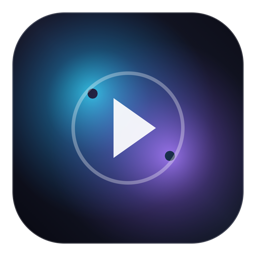
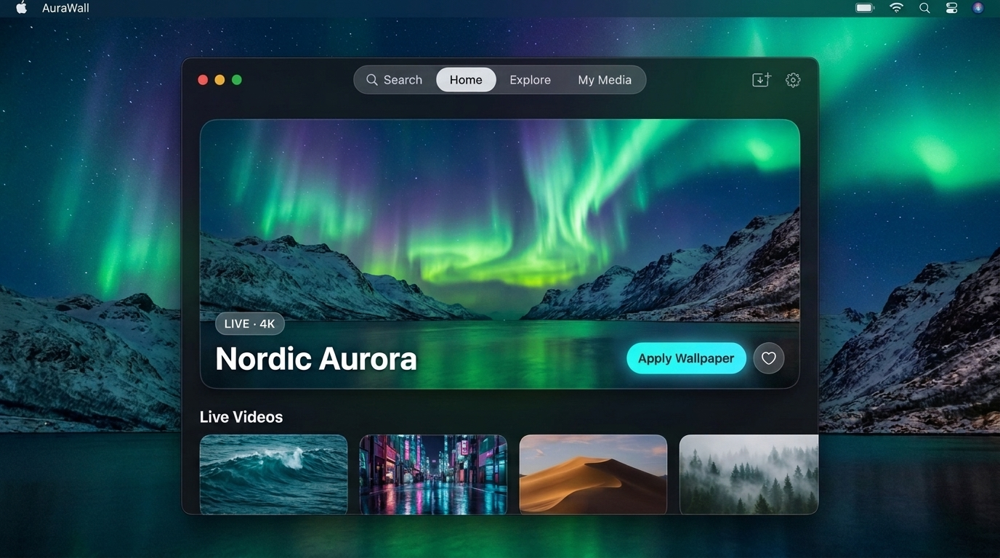
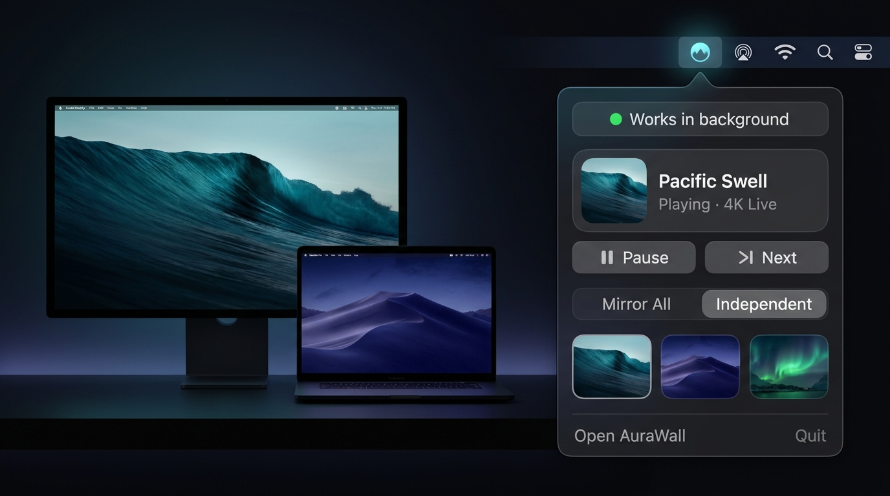
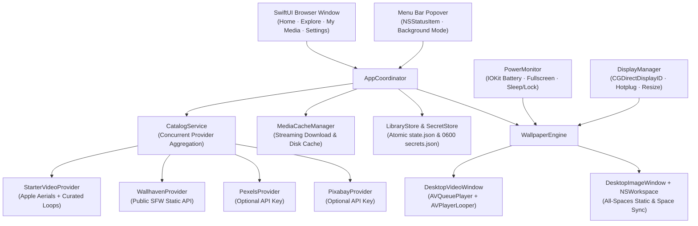

<p align="center">
  
</p>

<h1 align="center">AuraWall</h1>

<p align="center">
  <strong>A native macOS live video &amp; static wallpaper app built with Swift 6, SwiftUI, AppKit, and AVFoundation.</strong>
</p>

<p align="center">
  
  
  
  
</p>

<p align="center">
  
</p>

---

## Overview

**AuraWall** brings 4K looping video wallpapers and high-resolution static wallpapers to macOS without the memory overhead of Electron. Inspired by modern media-first macOS apps like Wallper, it pairs a translucent dark-glass browsing experience with a lightweight **Menu Bar background engine** that renders hardware-accelerated video directly behind your desktop icons across all displays and Mission Control Spaces.

---

## Key Features

- **Live Video & Static Wallpapers** — Seamless looping `MP4` / `MOV` playback via hardware-accelerated `AVQueuePlayer` + `AVPlayerLooper`, plus high-resolution static images (`JPG`, `PNG`, `HEIC`).
- **Works Out of the Box (Zero API Keys Required)** — Ships with built-in online catalogs for both live videos (**Apple Aerials** + curated 4K/HD fallback loops) and static wallpapers (**Wallhaven v1 SFW**), plus optional free API key integrations for **Pexels**, **Pixabay**, and custom remote JSON feeds.
- **All Mission Control Spaces & Multi-Display** — Choose **Mirror All** or **Independent** per-display wallpaper assignments. Both live videos and static wallpapers span every Mission Control Space (`Desktop 1`, `Desktop 2`, etc.) and automatically adapt to monitor hotplug or resolution changes.
- **Smart Power Saving** — Automatically pauses live video playback when running on **battery power** (with a one-click session override), when a **fullscreen app** occludes a display, or when the **display sleeps / screen locks**.
- **Menu Bar Background Mode** — Close the main window to hide the Dock icon and keep AuraWall running silently in the macOS menu bar with quick play/pause, next/random, display mode switching, and favorites.
- **Local Library & Imports** — Favorite wallpapers, manage downloaded disk cache, and drag-and-drop or import your own local video/image files (`My Media`).

<p align="center">
  
</p>

---

## How It Works

AuraWall separates its testable core engine (`AuraWallCore`) from the SwiftUI/AppKit macOS interface (`AuraWall`):



### Under the Hood
1. **Desktop Rendering Behind Icons:** `DesktopVideoWindow` and `DesktopImageWindow` are borderless, click-through (`ignoresMouseEvents = true`) `NSWindow` instances positioned at `CGWindowLevelForKey(.desktopWindow) + 1` with `.canJoinAllSpaces` and `.stationary` behaviors—so Finder icons remain fully interactive while wallpapers stay visible across every Space.
2. **Menu Bar Tinting & Space Persistence:** When applying a live video, `WallpaperEngine` extracts its first frame using `AVAssetImageGenerator` and applies it to macOS via `NSWorkspace.shared.setDesktopImageURL`, giving the translucent macOS menu bar natural color tinting and syncing native desktop images across Spaces on `activeSpaceDidChangeNotification`.
3. **Deterministic Power Policy:** `PowerMonitor` listens to `IOKit.ps` power source changes, display sleep/lock notifications, and per-display fullscreen window state, feeding them into `PowerPolicyEvaluator` to pause/resume each display's video decoder cleanly.

---

## Online Wallpaper Sources

| Provider | Media Types | API Key Required | Notes |
| --- | --- | --- | --- |
| **Starter Live Feed** | Live Video (4K/HD `.mov`/`.mp4`) | No | Apple Aerials catalog + curated fallback loops |
| **Wallhaven** | Static Images (HD/4K) | No (optional) | Public SFW search, toplist, resolution & aspect filters |
| **Pexels** | Live Video & Static Photos | Optional (Free) | Configured in Settings; unlocks large 4K video/photo library |
| **Pixabay** | Live Video & Static Photos | Optional (Free) | Configured in Settings; supports video & photo search |
| **Custom JSON Feed** | Live Video & Static Images | No | Point Settings to any HTTPS JSON wallpaper feed |

---

## Quick Start

### Requirements
- **macOS 14.0 (Sonoma) or later** (built and tested on Apple Silicon `arm64`)
- **Swift 6** via Xcode Command Line Tools (`xcode-select --install`) — **full Xcode is not required**

### Build & Run

```bash
# 1. Clone the repository
git clone https://github.com/holastre/aurawall.git
cd aurawall

# 2. Build and package the signed macOS .app bundle
bash ./scripts/bundle.sh

# 3. Launch AuraWall
open build/AuraWall.app
```

> **Tip:** To install it permanently, copy `build/AuraWall.app` into `/Applications`.

---

## Testing & Verification

AuraWall includes unit tests, adversarial edge-case tests, live API smoke checks, and a multi-tier E2E suite (running in isolated temporary directories without touching your desktop or `~/Library`):

```bash
# Run core unit & adversarial tests (offline)
swift test --disable-sandbox

# Run live feed smoke checks (Apple Aerials + Wallhaven)
AURAWALL_RUN_LIVE_SMOKE=1 swift test --disable-sandbox --filter LiveSmoke

# Run full offline E2E verification suite (SwiftE2E + Python Tiers 1–4 + .app bundle)
bash ./scripts/e2e_run.sh --full --tier all --no-live
```

For interactive GUI, multi-display, and power-management checks, see [docs/MANUAL_VERIFICATION.md](docs/MANUAL_VERIFICATION.md).

---

## Project Structure

```text
aurawall/
├── Package.swift                 # SwiftPM manifest (AuraWallCore, AuraWall, AuraWallCoreTests)
├── Resources/
│   ├── AppIcon.icns              # macOS app icon
│   └── Info.plist                # Bundle metadata
├── Sources/
│   ├── AuraWallCore/             # Testable core library
│   │   ├── Cache/                # MediaCacheManager
│   │   ├── Engine/               # WallpaperEngine, DesktopVideoWindow, DesktopImageWindow, DisplayManager
│   │   ├── Models/               # WallpaperItem, DisplayConfig, PowerModels
│   │   ├── Persistence/          # LibraryStore, SecretStore, LocalMediaImporter
│   │   ├── Power/                # PowerMonitor, PowerPolicyEvaluator
│   │   └── Providers/            # CatalogService, StarterVideo, Wallhaven, Pexels, Pixabay
│   └── AuraWall/                 # SwiftUI + AppKit macOS app
│       ├── MenuBar/              # MenuBarController, MenuBarPopoverView
│       └── Views/                # Home, Explore, My Media, Settings, Detail Sheet, Components
├── Tests/
│   ├── AuraWallCoreTests/        # Unit & Tier 5 adversarial tests + fixtures
│   └── E2E/                      # SwiftE2E & Python Tiers 1–4 E2E suite
├── docs/
│   ├── MANUAL_VERIFICATION.md    # Interactive macOS verification checklist
│   └── assets/                   # README visuals & app icon
└── scripts/
    ├── bundle.sh                 # Release arm64 build & .app bundler
    └── e2e_run.sh                # Automated E2E test runner
```

---

## Privacy & Local Storage

- **No telemetry or analytics.** Network requests go strictly to the wallpaper providers you browse or configure.
- App state and cached media are stored locally in `~/Library/Application Support/AuraWall/` and `~/Library/Caches/AuraWall/`.
- Optional API keys are saved in `~/Library/Application Support/AuraWall/secrets.json` with strict owner-only permissions (`0600`).
